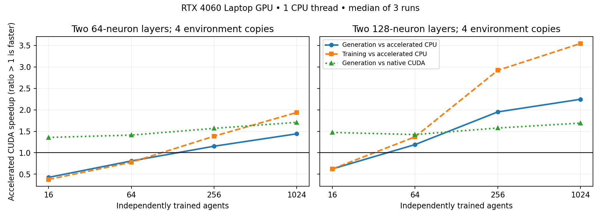

# Accelerated PPO measurements — 2026-11-05

Measured locally on NVIDIA GeForce RTX 4060 Laptop GPU (8 GiB), Windows/WDDM, PyTorch 2.12.1+cu126. CPU baselines use one PyTorch thread. These are measurements of this machine and workload, not a general hardware ranking.

GPU correctness validation passed 50 tests and 21 subtests, with no skips. The only warning was SB3's expected warning about MLP PPO GPU utilization.

The main matrix uses TensorReach1D on the policy device, two hidden layers, 256 requested training interactions per agent per generation, 32 rollout steps, two PPO epochs, minibatches of 32, and two complete generations per run. Every configuration has one complete warmup and three measured repeats. Times below are medians in seconds per generation. Complete generation time includes initialization, training, breeding, frozen validation, CPU archive evaluation, and final result copies. Disk output is excluded.

Training and evaluation interaction counts and PPO update counts match across compared routes. Stochastic training streams differ between native and accelerated paths; fitness is not a matched-trajectory comparison.

A ratio above 1 means accelerated CUDA is faster than the named reference. The CPU reference in the figure is the accelerated implementation with one PyTorch thread.

## Findings

At 1,024 agents with two 128-neuron layers and four copies, accelerated CUDA takes 6.75 s per generation, versus 11.42 s for native CUDA and 15.16 s for accelerated one-thread CPU. That is 1.69× and 2.25× faster, respectively. Training alone takes 3.14 s at 83,550 transitions/s. Peak PyTorch CUDA allocation is 756.3 MiB.

A four-thread CPU check reduces the same accelerated CPU case to 10.00 s per generation. CUDA remains 1.48× faster end to end and 1.97× faster for training. The complete crossover matrix below uses one CPU thread; four threads were tested only for this largest case.

The first observed accelerated CUDA generation win against accelerated one-thread CPU is 64 agents for width 128 with four copies; 256 agents for width 128 with one copy, or width 64 with four copies; and 1,024 agents for width 64 with one copy. Width 16 never wins on CUDA in this range. These are sampled observations; near ties are not evidence of a precise threshold.

The action-randomness ablation raises rollout time from 0.185 s to 1.198 s when batching is disabled (6.46× slower). Disabling actor/critic reuse raises it to 0.245 s (1.32× slower). Disabling preallocation raises rollout time to 0.221 s, but its measured complete-generation median is slightly faster than the full accelerated configuration. Preallocation has no demonstrated end-to-end gain in these repeats; these ratios are not additive and small differences are noisy.

For 256 growing agents (initial layers 32, capacity 64), native CUDA takes 38.96 s per generation and accelerated CUDA takes 1.69 s, a 22.99× gain. Accelerated CPU takes 1.63 s. Batching growth removes a large serial-training cost on both devices; this case does not show a clear CUDA advantage over batched CPU.

Chunking the largest case to 256 agents reduces peak PyTorch allocation from 756.3 MiB to 201.1 MiB and changes generation time from 6.75 s to 7.23 s (7.1% slower). Actual interactions, updates, and final mean fitness match the unchunked accelerated run.

The largest accelerated CUDA case spends about 53.5% of total time outside learning. Setup plus export add about another 24.9%; rollout and PPO updates together account for about 21.1%. Short, two-generation runs include initialization and final result materialization, so longer runs or larger per-generation budgets may differ. Packing policies for evaluation, reproduction, and CPU state materialization are the next targets. Weights and Adam remain on device during each training call; cross-generation residency is not implemented. Capacity buckets, compilation, and CUDA Graphs were not benchmarked.

## Complete generation times

### Layers (16, 16), 1 environment copies

| Agents | Native CPU | Accelerated CPU | Native CUDA | Accelerated CUDA | Gain vs native CUDA | Gain vs accelerated CPU |
| --- | --- | --- | --- | --- | --- | --- |
| 16 | 0.367 | 0.279 | 1.453 | 0.978 | 1.49× | 0.29× |
| 64 | 0.694 | 0.477 | 2.103 | 1.261 | 1.67× | 0.38× |
| 256 | 2.006 | 1.373 | 4.804 | 2.352 | 2.04× | 0.58× |
| 1024 | 7.901 | 5.373 | 16.395 | 7.123 | 2.30× | 0.75× |

### Layers (16, 16), 4 environment copies

| Agents | Native CPU | Accelerated CPU | Native CUDA | Accelerated CUDA | Gain vs native CUDA | Gain vs accelerated CPU |
| --- | --- | --- | --- | --- | --- | --- |
| 16 | 0.226 | 0.174 | 0.639 | 0.444 | 1.44× | 0.39× |
| 64 | 0.463 | 0.366 | 1.146 | 0.703 | 1.63× | 0.52× |
| 256 | 1.488 | 1.195 | 2.321 | 1.514 | 1.53× | 0.79× |
| 1024 | 5.492 | 4.552 | 8.216 | 4.764 | 1.72× | 0.96× |

### Layers (64, 64), 1 environment copies

| Agents | Native CPU | Accelerated CPU | Native CUDA | Accelerated CUDA | Gain vs native CUDA | Gain vs accelerated CPU |
| --- | --- | --- | --- | --- | --- | --- |
| 16 | 0.411 | 0.310 | 1.387 | 1.019 | 1.36× | 0.30× |
| 64 | 0.911 | 0.663 | 2.075 | 1.286 | 1.61× | 0.52× |
| 256 | 3.735 | 2.407 | 5.558 | 2.577 | 2.16× | 0.93× |
| 1024 | 11.587 | 7.987 | 16.513 | 7.388 | 2.24× | 1.08× |

### Layers (64, 64), 4 environment copies

| Agents | Native CPU | Accelerated CPU | Native CUDA | Accelerated CUDA | Gain vs native CUDA | Gain vs accelerated CPU |
| --- | --- | --- | --- | --- | --- | --- |
| 16 | 0.269 | 0.201 | 0.642 | 0.473 | 1.36× | 0.43× |
| 64 | 0.791 | 0.609 | 1.063 | 0.753 | 1.41× | 0.81× |
| 256 | 2.315 | 1.945 | 2.649 | 1.689 | 1.57× | 1.15× |
| 1024 | 9.301 | 7.464 | 8.850 | 5.179 | 1.71× | 1.44× |

### Layers (128, 128), 1 environment copies

| Agents | Native CPU | Accelerated CPU | Native CUDA | Accelerated CUDA | Gain vs native CUDA | Gain vs accelerated CPU |
| --- | --- | --- | --- | --- | --- | --- |
| 16 | 0.632 | 0.406 | 1.364 | 0.965 | 1.41× | 0.42× |
| 64 | 1.690 | 1.091 | 2.260 | 1.401 | 1.61× | 0.78× |
| 256 | 7.424 | 4.287 | 5.326 | 2.961 | 1.80× | 1.45× |
| 1024 | 29.634 | 16.562 | 18.083 | 8.851 | 2.04× | 1.87× |

### Layers (128, 128), 4 environment copies

| Agents | Native CPU | Accelerated CPU | Native CUDA | Accelerated CUDA | Gain vs native CUDA | Gain vs accelerated CPU |
| --- | --- | --- | --- | --- | --- | --- |
| 16 | 0.464 | 0.317 | 0.750 | 0.509 | 1.47× | 0.62× |
| 64 | 1.188 | 0.914 | 1.094 | 0.768 | 1.42× | 1.19× |
| 256 | 4.540 | 3.611 | 2.918 | 1.851 | 1.58× | 1.95× |
| 1024 | 19.493 | 15.165 | 11.418 | 6.751 | 1.69× | 2.25× |

## Largest population phase times

Two 128-neuron layers, four environment copies, 1,024 agents. Phase medians need not sum exactly to the median total.

| Route | Setup | Rollout | PPO | Export | Learning | Generation | Training transitions/s | Peak CUDA MiB |
| --- | --- | --- | --- | --- | --- | --- | --- | --- |
| cpu/native | 1.075 | 4.800 | 7.645 | 0.477 | 14.106 | 19.493 | 18,583 | — |
| cpu/accelerated | 1.090 | 1.897 | 7.638 | 0.456 | 11.129 | 15.165 | 23,554 | — |
| cuda/native | 1.263 | 2.630 | 1.028 | 1.659 | 6.818 | 11.418 | 38,451 | 748.3 |
| cuda/accelerated | 1.164 | 0.463 | 0.959 | 0.518 | 3.138 | 6.751 | 83,550 | 756.3 |

## Observed crossovers

First measured population where CUDA beats the same implementation on CPU. An unobserved win is marked 'none'. The small number of repeats does not establish statistical significance for near ties.

| Width | Copies | Implementation | Training win | Complete generation win |
| --- | --- | --- | --- | --- |
| 16 | 1 | accelerated | none | none |
| 16 | 1 | native | none | none |
| 16 | 4 | accelerated | none | none |
| 16 | 4 | native | none | none |
| 64 | 1 | accelerated | 1024 | 1024 |
| 64 | 1 | native | none | none |
| 64 | 4 | accelerated | 256 | 256 |
| 64 | 4 | native | 1024 | 1024 |
| 128 | 1 | accelerated | 256 | 256 |
| 128 | 1 | native | 256 | 256 |
| 128 | 4 | accelerated | 64 | 64 |
| 128 | 4 | native | 64 | 64 |

## GPU ablations

Exact arguments and raw sample ranges are retained in the JSON snapshot.

1,024 agents, layers (64, 64), four copies, 128 interactions per agent, two epochs with minibatches of 32, one generation per run, one warmup and three repeats.

| Agents | Device | Variant | Chunk | Rollout | Learning | Generation | Peak CUDA MiB |
| --- | --- | --- | --- | --- | --- | --- | --- |
| 1024 | cuda | accelerated | all | 0.185 | 2.217 | 5.324 | 227.7 |
| 1024 | cuda | no-reuse | all | 0.245 | 2.275 | 5.353 | 210.6 |
| 1024 | cuda | no-buffers | all | 0.221 | 2.109 | 5.119 | 227.7 |
| 1024 | cuda | no-batch-rng | all | 1.198 | 3.061 | 6.002 | 227.2 |

## Neural growth

Exact arguments and raw sample ranges are retained in the JSON snapshot.

Initial layers (32, 32), capacity 64, four copies, 128 interactions per agent, two epochs with minibatches of 128, one generation per run, one warmup and three repeats.

| Agents | Device | Variant | Chunk | Rollout | Learning | Generation | Peak CUDA MiB |
| --- | --- | --- | --- | --- | --- | --- | --- |
| 64 | cpu | native | all | 1.440 | 2.558 | 2.808 | — |
| 64 | cpu | accelerated | all | 0.055 | 0.368 | 0.582 | — |
| 64 | cuda | native | all | 5.644 | 9.322 | 9.666 | 16.8 |
| 64 | cuda | accelerated | all | 0.064 | 0.366 | 0.591 | 41.7 |
| 256 | cpu | native | all | 5.046 | 8.787 | 9.647 | — |
| 256 | cpu | accelerated | all | 0.107 | 0.995 | 1.630 | — |
| 256 | cuda | native | all | 23.141 | 37.987 | 38.962 | 18.6 |
| 256 | cuda | accelerated | all | 0.077 | 1.039 | 1.695 | 118.1 |

## Population chunks

Exact arguments and raw sample ranges are retained in the JSON snapshot.

| Agents | Device | Variant | Chunk | Rollout | Learning | Generation | Peak CUDA MiB |
| --- | --- | --- | --- | --- | --- | --- | --- |
| 1024 | cuda | accelerated | 256 | 0.630 | 3.783 | 7.230 | 201.1 |

## Additional CPU thread check

Exact arguments and raw sample ranges are retained in the JSON snapshot.

This check uses **four PyTorch CPU threads**; it otherwise matches the largest main-matrix configuration.

| Agents | Device | Variant | Chunk | Rollout | Learning | Generation | Peak CUDA MiB |
| --- | --- | --- | --- | --- | --- | --- | --- |
| 1024 | cpu | accelerated | all | 0.753 | 6.191 | 9.996 | — |

## Profile operation counts

Profiled separately at 1,024 agents, width 64, four copies. Counts are from complete trace events; profiler duration includes instrumentation and is not a speed measurement.

| Profile | rand | randperm | bmm | copy_ | clone | GPU kernels |
| --- | --- | --- | --- | --- | --- | --- |
| cuda_accelerated | 6144 | 8192 | 652 | 100047 | 49516 | 38072 |
| cuda_native | 65536 | 8192 | 1600 | 163019 | 49508 | 101590 |

Both traces contain the same PPO work (128 interactions per agent, two generations, 32-step rollouts, two epochs). Native records shapes/memory; accelerated uses lighter tracing. Profiler durations are therefore not compared. CPU operator events can include nested dispatch calls, so these are relative operation counts, not physical random draws. Total rand events drop from 65,536 to 6,144, and bmm events from 1,600 to 652. Both still contain 8,192 randperm events and about 49,500 clone events. Per-agent shuffle launches and host population/state construction remain scaling limits. Archive scoring is small in these traces.

The native and accelerated raw traces were fully written. PyTorch's in-memory operator-table aggregation was stopped after it used several GiB and minutes of CPU time; summaries above were produced by a streaming JSON reader instead. The harness now makes expensive table aggregation optional with --profile-table, and shapes/memory with --profile-detailed.

## Reproduction and raw data

The [compact JSON snapshot](accelerated_ppo_benchmarks_2026-11-05.json) includes all measured medians, sample ranges, arguments, hardware/source metadata, and computed comparisons. Full raw samples and profiler traces are under `results/benchmarks/cuda_2026-11-05/` (ignored local artifacts). [Benchmark commands and timing definitions](accelerated_ppo.md) describe the harness.

Phase timings synchronize CUDA around each section; this adds synchronization overhead. Profiles disable these phase barriers and are separate from timing runs. Neither compilation nor CUDA Graphs are enabled. Cached reserved CUDA memory is distinct from peak live allocation.
